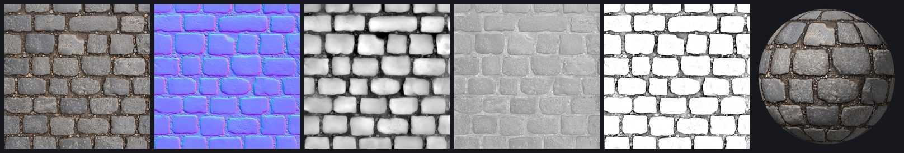

# Normal Map Generator

The normal map generator engine behind [normalmap.io](https://normalmap.io), as a TypeScript library. It turns a photo or texture into a full PBR map set (normal, height, displacement, roughness and ambient occlusion) and runs entirely in the browser or in Node, with no server and no upload.

**Try it online: [normalmap.io](https://normalmap.io)**, drop in a photo and check the maps on a lit 3D sphere.



## Features

- **Two ways to read the surface.** Image mode works from the picture itself, multi-scale, with separate weights for fine, medium and large bumps. AI photo mode runs the [DeepBump](https://github.com/HugoTini/DeepBump) network, which tells real bumps from shadows and color changes.
- **Height maps stay height maps.** A clean grayscale height map is detected and converted with its real slopes, so a dome stays a dome instead of being flattened.
- **Real height from normals.** Height and displacement come from integrating the normal field (Frankot-Chellappa, FFT), not from brightness.
- **Roughness and ambient occlusion** from the same surface, with contrast, level and invert controls.
- **Seamless textures.** A variance-preserving blend makes any image tile, and every filter wraps at the edges.
- **OpenGL or DirectX** normal maps (green channel up or down).
- **16-bit PNG** for height and displacement, an **RGBA PNG** writer that keeps straight alpha for packed maps (Unity metallic + smoothness, HDRP mask), and a ZIP writer for the whole set. No image libraries needed.
- **Software material balls** (`shadeSphere`), with optional displacement that changes the outline, for thumbnails and docs.
- **WebGL2 3D preview**: plane or sphere with displacement, lit by a light that follows the pointer.
- **Tiled inference** for any 256 px image-to-normals model, at any image size, without visible tile seams.

## Install

```bash
pnpm add github:xiaoyanng/normal-map-generator
```

## Use it in the browser

```ts
import {
  computeMaps,
  DEFAULT_SETTINGS,
  fitSize,
  rgbFromRgba,
  toRgba,
} from 'normal-map-generator';

async function mapsFromFile(file: File) {
  const bitmap = await createImageBitmap(file);
  const { width, height } = fitSize(bitmap.width, bitmap.height, 1024);
  const canvas = new OffscreenCanvas(width, height);
  const ctx = canvas.getContext('2d')!;
  ctx.drawImage(bitmap, 0, 0, width, height);
  const image = rgbFromRgba(ctx.getImageData(0, 0, width, height).data, width, height);

  const maps = computeMaps(image, { ...DEFAULT_SETTINGS, source: 'image' });
  // RGBA bytes, ready for an ImageData or an 8-bit PNG.
  return {
    normal: toRgba(...maps.normal),
    roughness: toRgba(maps.roughness),
    ao: toRgba(maps.ao),
    height: maps.heightMap, // 0..1 floats, see encodeGray16Png
  };
}
```

The engine is pure functions on `Float32Array`s, so it moves into a Web Worker as is. normalmap.io runs it in one to keep the page responsive.

### Settings

| Setting | Default | What it does |
|---|---|---|
| `source` | `'ai'` | `'image'` reads the picture itself, `'ai'` uses the normals you pass in |
| `strength` | `1` | Overall bump strength |
| `fine`, `medium`, `large` | `1` | Weight of small, medium and large bumps (image mode) |
| `flattenLighting` | `false` | Drops the largest shapes, for photos lit unevenly |
| `invert` | `false` | Bright is low instead of high (image mode) |
| `format` | `'opengl'` | `'directx'` flips the green channel |
| `tile` | `false` | The image tiles (run `makeSeamless` on it first) |
| `roughnessContrast`, `roughnessLevel`, `roughnessInvert` | `1`, `0`, `false` | Roughness tuning |
| `aoStrength` | `1` | Ambient occlusion strength |

### OpenGL or DirectX?

| Engine | Format |
|---|---|
| Blender, Unity, Godot, Maya, three.js | OpenGL (Y+) |
| Unreal Engine, 3ds Max, CryEngine | DirectX (Y-) |

## AI photo mode

The AI mode uses DeepBump by Hugo Tini, an open-source network trained on material scans. The model file is **not** part of this repository: download `deepbump256.onnx` from the [DeepBump repository](https://github.com/HugoTini/DeepBump) and run it with [onnxruntime-web](https://onnxruntime.ai/). The model is licensed under GPL-3.0 by its author; check that license before you ship it.

```ts
import * as ort from 'onnxruntime-web';
import { channelMean, computeMaps, DEFAULT_SETTINGS, inferNormals, TILE } from 'normal-map-generator';

// `image` comes from rgbFromRgba, as in the browser example above.
const session = await ort.InferenceSession.create('/models/deepbump256.onnx');
const aiNormal = await inferNormals(
  channelMean(image),
  image.width,
  image.height,
  async (tile) => {
    const input = new ort.Tensor('float32', tile, [1, 1, TILE, TILE]);
    const out = await session.run({ [session.inputNames[0]]: input });
    return out[session.outputNames[0]].data as Float32Array;
  },
  { onProgress: (done, total) => console.log(`${done}/${total}`) }
);
const maps = computeMaps(image, DEFAULT_SETTINGS, aiNormal);
```

`inferNormals` is written for this library and works with any model that takes a 256 x 256 grayscale tile and returns three normal channels. It pads the image, covers it with evenly spaced overlapping tiles and cross-fades them with a flat-topped window, so tile edges never show.

## Command line example

```bash
pnpm install
pnpm example photo.jpg --out out                     # image mode
pnpm example photo.jpg --model deepbump256.onnx      # AI photo mode
pnpm example photo.jpg --seamless --directx --strength 1.5
```

It writes `normal.png`, `height.png` (16-bit), `roughness.png`, `ao.png` and `ball.png`, a lit material ball to check the result.

## How it works

1. **Slopes.** In image mode the luminance is split into fine, medium, large and base bands, each weighted and differentiated with a Sobel filter. Photo slopes are scaled to a fixed target strength, so dark and bright photos come out alike; clean height maps keep their real slopes.
2. **Normals.** The slopes become unit normals, encoded as RGB (128, 128, 255 is flat).
3. **Height.** The slope field is integrated in the Fourier domain (Frankot-Chellappa) on a mirrored, power-of-two grid, which gives a height map that agrees with the normals.
4. **Ambient occlusion** comes from the cavities of that height, **roughness** from luminance and cavities together.
5. **Seamless** images are blended from four half-offset copies with weights that vanish on each copy's seam, keeping the original contrast.

## Tests

```bash
pnpm test        # unit tests, including a dome height map that must stay a dome
pnpm typecheck
```

## Contributing

Issues and pull requests are welcome. The engine is developed inside normalmap.io and copied here; merged changes are ported back to the site.

## License

MIT, see [LICENSE](LICENSE). The DeepBump model is not included and keeps its own GPL-3.0 license.
